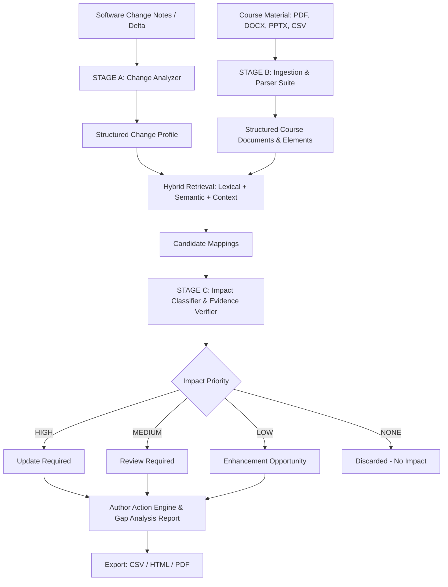

# iSync — Intelligent Course Update & Gap Analysis Agent

**iSync** is an AI agent engineered specifically for the **iGETIT content architecture team at Tata Technologies**. Its sole purpose is to compare engineering software/version changes against existing multi-format course curriculum (PDF, PPTX, DOCX, CSV) and tell course authors **exactly what needs to be reviewed, updated, or enhanced**, supported by verbatim grounded evidence.

---

## 🚀 Key Highlights & Capabilities

- **Zero-Hallucination Evidence Grounding:** Every finding quotes exact text, headings, and page/slide numbers from the source course files. If evidence cannot be automatically verified, it explicitly flags `"Review Required — insufficient evidence for automatic classification."`
- **Precision Over Quantity:** Distinguishes between merely *related* terminology and *actually impacted* instructional steps. No noisy 50-item keyword dumps.
- **100% Offline Demo Mode:** Fully functional out-of-the-box without requiring third-party API keys or external services, while also supporting optional Google Gemini API models.
- **Multi-Format Document Parsing:**
  - **PDF:** Page-by-page text blocks, headings, embedded screenshots/figures via `pymupdf` (with `pdfplumber` fallback).
  - **DOCX:** Hierarchical module/lesson/section headings, paragraphs, tables, and inline drawing detections via `python-docx`.
  - **PPTX:** Slide numbers, titles, bullet hierarchy, speaker notes, and diagram picture shapes via `python-pptx`.
  - **CSV:** Tabular curriculum indices, glossaries, and question banks via `pandas`.
- **Hybrid Retrieval Engine:** Combines BM25/lexical token overlap, term inflection/stemming, TF-IDF cosine semantic similarity, and document heading context.
- **Enterprise-Grade Reporting:** Export complete findings dossiers in **CSV**, **HTML**, and **PDF** (via `reportlab`).

---

## 🏗️ Core Architecture & Workflow



### 1. Stage A — Change Analysis (What Changed?)
Extracts changes and classifies them into:
- `New Feature`
- `Modified Feature`
- `UI Change`
- `Terminology Change`
- `Workflow Change`
- `Deprecated Feature`
- `Removed Feature`

### 2. Stage B — Course Gap Analysis (Where does it affect the course?)
Parses course documents while preserving:
- Document filename
- Content type (Paragraph, Heading, Screenshot/Image, Table, Glossary Entry)
- Module, Lesson, Section, and Heading hierarchy
- Exact Page / Slide numbers
- Embedded images and surrounding captions

### 3. Stage C — Author Action (What must the author do?)
For each impacted area, iSync provides:
- **Detected Change:** Description of the software delta.
- **Location:** Complete breadcrumb (e.g. `Sketching.pdf → Module 2 → Lesson 3 → Sketch Environment → Page 3`).
- **Affected Content:** Verbatim course excerpt.
- **Evidence:** Exact grounded quotation.
- **Why This Was Flagged:** Clear technical rationale.
- **Recommended Action:** Specific instructions (e.g., *"Replace screenshot on Page 3 and review button names"*).
- **Priority:** `HIGH`, `MEDIUM`, or `LOW`.
- **Confidence:** `High`, `Medium`, or `Low`.

---

## 📁 Project Structure

```
iSync/
├── app/
│   ├── main.py                  # Streamlit Enterprise UI (Executive Summary, Impact Map, Action Plan)
│   ├── config.py                # Runtime settings, paths, and thresholds
│   ├── models/                  # Pydantic schemas (SoftwareChange, ContentChunk, Finding, ActionItem, etc.)
│   │   ├── schemas.py           # Core strongly typed models
│   │   └── __init__.py          # Exported schemas
│   ├── parsers/                 # Multi-format document parser suite
│   │   ├── pdf_parser.py        # PyMuPDF / pdfplumber parser (headings, pages, screenshots)
│   │   ├── docx_parser.py       # python-docx parser (headings, paragraphs, tables)
│   │   ├── pptx_parser.py       # python-pptx parser (slides, titles, text, notes)
│   │   ├── csv_parser.py        # pandas CSV parser (rows, columns, row numbers)
│   │   ├── txt_parser.py        # Plain text parser with line-level tracking
│   │   ├── loader.py            # Unified DocumentLoader dispatcher
│   │   └── __init__.py          # Exported parsers
│   ├── analysis/                # Intelligent gap analysis pipeline
│   │   ├── change_extractor.py  # 12-category software delta extraction & profiling
│   │   ├── semantic_retriever.py# Hybrid lexical + TF-IDF cosine semantic similarity
│   │   ├── impact_analyzer.py   # Priority classification, evidence grounding, OLD -> NEW states
│   │   ├── deduplicator.py      # Precision deduplication across locations
│   │   ├── pipeline.py          # Unified GapAnalysisPipeline orchestrator
│   │   └── __init__.py          # Exported analysis modules
│   ├── export/                  # Multi-format report exporters
│   │   ├── csv_exporter.py      # Tabular CSV export
│   │   ├── html_exporter.py     # Standalone enterprise HTML report
│   │   ├── pdf_exporter.py      # Executive PDF dossier (ReportLab)
│   │   └── __init__.py          # Exported exporters
│   └── ui/                      # Streamlit UI Views (Native components, zero raw HTML leaks)
│       ├── theme.py             # Scoped CSS styling (metrics, expanders, fonts)
│       ├── sidebar.py           # 4-section left sidebar (Software, Documents, Analysis, Exports)
│       ├── executive_summary.py # High-level metric cards & overall impact ratio
│       ├── impact_map.py        # Filterable & searchable Document Impact Map table
│       ├── action_plan.py       # "What exactly do I need to change?" with OLD -> NEW comparisons
│       ├── findings_view.py     # Expandable finding dossiers with verbatim quotes
│       ├── not_affected_view.py # Explicit verification for untouched course material
│       └── __init__.py          # Exported UI views
├── tests/                       # Complete Pytest test suite (26 passing tests)
│   ├── test_schemas.py          # Pydantic schemas and validation tests
│   ├── test_parsers.py          # PDF, DOCX, PPTX, CSV, TXT parser tests
│   ├── test_change_extractor.py # Software delta classification and terminology tests
│   ├── test_retriever.py        # Hybrid lexical and semantic retrieval tests
│   ├── test_impact_analyzer.py  # Priority logic and evidence grounding tests
│   ├── test_deduplicator.py     # Duplicate prevention tests
│   ├── test_exports.py          # CSV, HTML, and PDF export validation tests
│   └── test_acceptance_criteria.py # Full benchmark acceptance tests (Scenarios 37, 38, 39)
├── sample_data/                 # Pre-built benchmark data (SOLIDWORKS 2024 → 2025)
│   ├── changes.txt              # Official delta notes covering 5 distinct software changes
│   └── course_files/            # 5 realistic multi-format curriculum files
│       ├── Sketching_Fundamentals.pdf
│       ├── Constraints_and_Mates.pptx
│       ├── Advanced_Parts_Assembly.docx
│       ├── Feature_Glossary_Index.csv
│       └── Introduction_and_Overview.pdf  # Verified unaffected control document
├── outputs/                     # Generated CSV, HTML, and PDF report exports
├── scripts/
│   ├── generate_sample_data.py  # Generates realistic test curriculum
│   └── run_demo.py              # 1-command CLI benchmark runner
├── requirements.txt             # Clean dependencies
├── .env.example
├── .gitignore
└── README.md
```

---

## ⚡ Quick Start & Commands

### 1. Install Dependencies
```bash
pip install -r requirements.txt
```

### 2. Run the Web Application
```bash
python -m streamlit run app/main.py
```
Open **`http://localhost:8501`** in your browser.
- Click **"🚀 RUN DEMO (SOLIDWORKS 2024 → 2025)"** in the sidebar to execute the benchmark with 1 click.
- Or enter your own software name, version, change notes, and upload course files.

### 3. Run the CLI Demo (No Browser Needed)
```bash
python scripts/run_demo.py
```
Executes the full pipeline, displays the finding summary and detailed author recommendations, and saves the CSV, HTML, and PDF dossiers into `outputs/`.

### 4. Run the Test Suite
```bash
python -m pytest -v
```

---

## 📊 SOLIDWORKS 2024 → 2025 Benchmark Scenario

| Change ID | Change Definition | Category | Impacted Document & Location | Priority | Recommended Action |
|:---|:---|:---|:---|:---:|:---|
| **CHG-001** | Sketch toolbar redesigned | UI Change | `Sketching_Fundamentals.pdf` (Page 3) | **HIGH** | Replace toolbar screenshot (Figure 2-1) & update command ribbon instructions. |
| **CHG-002** | Constraints panel moved | Workflow Change | `Constraints_and_Mates.pptx` (Slide 2) | **MEDIUM** | Validate step sequence; redirect learner from floating panel to FeatureManager tree. |
| **CHG-003** | Mate Controller renamed to Kinematic Assembly Controller | Terminology Change | `Advanced_Parts_Assembly.docx` (Lesson 1) & `Feature_Glossary_Index.csv` (Row 1) | **HIGH** | Update all occurrences of obsolete term "Mate Controller" to new terminology. |
| **CHG-004** | Legacy 2D Drawing Export deprecated | Deprecated Feature | `Advanced_Parts_Assembly.docx` (Lesson 2) & `Feature_Glossary_Index.csv` (Row 2) | **HIGH** | Refactor/remove deprecated procedure; replace with MBD 3D PDF workflow. |
| **CHG-005** | AI-Assisted Hole Wizard introduced | New Feature | `Advanced_Parts_Assembly.docx` (Lesson 3) | **LOW** | Add enhancement demonstration showcasing automatic hole and fastener sizing. |
| *N/A* | General model saving, units, tolerances, interference detection | None | Multiple documents | **NONE** | Unrelated content is correctly discarded. |
